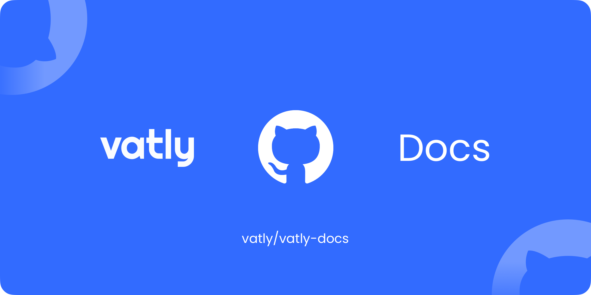

# Vatly Docs

API documentation for [Vatly](https://vatly.com), the Merchant of Record for European software and digital products.

**Live at [docs.vatly.com](https://docs.vatly.com)**

## Stack

- [Docus](https://docus.dev) (Nuxt Content + Nuxt UI)
- Static site deployed via GitHub Pages

## Development

```bash
npm install
npx nuxi dev
```

## Build & Deploy

```bash
npx nuxi build
npx gh-pages --dotfiles -d .output/public
```

## Structure

```
content/
├── index.md                      # Landing page (overridden by app/pages/index.vue)
├── 1.guides/                     # Guides (quickstart, auth, pagination, etc.)
└── 2.api-reference/              # API reference (customers, checkouts, etc.)
app/
├── app.config.ts                 # Docus theme config (logo, colors)
└── pages/index.vue               # Custom landing page
public/
├── openapi.yaml                  # OpenAPI 3.1.0 spec
└── vatly-logo-*.{svg,png}        # Brand assets
```

## Package documentation sync

`.github/workflows/sync-sdk-docs.yml` receives `repository_dispatch` events
and supports a manual **Sync SDK Docs** run. It pulls package `docs/*.md` from
`main`, converts them to ordered Docus pages, regenerates the sitemap, creates
a signed commit through the GitHub API, then builds and deploys to GitHub Pages
when content changes. The explicit deploy is necessary because commits made
with `GITHUB_TOKEN` do not start another push workflow.

### Existing PHP sources

| Source | Sender | Event | Destination |
| --- | --- | --- | --- |
| `vatly/vatly-api-php` | `notify-docs.yml` / Notify Docs | `sync-sdk-docs` | `content/3.packages/1.php` |
| `vatly/vatly-laravel` | `notify-docs.yml` / Trigger Docs Sync | `sync-laravel-docs` | `content/3.packages/2.laravel` |

Both senders trigger on pushes to `main` affecting `docs/**`, using
`peter-evans/repository-dispatch` and `VATLY_DOCS_DISPATCH_TOKEN`. There is no
release/tag gate. Either event refreshes both PHP sources. Fluent PHP and the
WordPress plugin have no docs notifier and are not imported by this workflow.
The PHP transformers mirror markdown pages, rewrite links and GitHub alerts,
and preserve existing frontmatter.

### JavaScript sources (opt-in, disabled by default)

| Source | Event | Destination | Enabling repository variable |
| --- | --- | --- | --- |
| `vatly/vatly-api-js` (`@getvatly/sdk`) | `sync-js-docs` | `content/3.packages/3.javascript` | `SYNC_JS_DOCS` |
| `vatly/vatly-fluent-js` (`@getvatly/fluent`) | `sync-fluent-js-docs` | `content/3.packages/4.fluent-js` | `SYNC_FLUENT_JS_DOCS` |
| `vatly/vatly-better-auth` (`@getvatly/better-auth`) | `sync-better-auth-docs` | `content/3.packages/5.better-auth` | `SYNC_BETTER_AUTH_DOCS` |

JS senders mirror the PHP API sender: **Notify Docs**, `notify-docs.yml`, push
to `main`, `docs/**`, dispatch action v4, same dispatch secret. The receiver
requires the relevant Actions **repository variable in vatly-docs** to equal
the literal string `true`, even on manual runs. Leave these variables absent
until each package is released and its docs are approved for public viewing.
No JS pages or navigation entries are checked in before activation. Once
enabled, imports track `main`, not releases, just like PHP.

To launch a package's docs:

1. Add flat `docs/*.md` in the package repo (start with `docs/README.md`).
   Fluent JS does not have this directory yet. The transformer rejects missing
   or empty docs before deleting any previous pages. It handles sibling links
   with anchors, source/assets links, GitHub alerts, and frontmatter. README
   becomes `/packages/<destination-name>/readme`, matching PHP, not an index.
2. Configure `VATLY_DOCS_DISPATCH_TOKEN` as an Actions secret in **each source
   package repo**, or grant it access through an organization secret. Use a
   fine-grained PAT with access to **vatly/vatly-docs** and **Contents: write**
   (or the existing PHP dispatch credential if appropriately scoped). The
   source repo's built-in `GITHUB_TOKEN` cannot dispatch to another repo.
3. If a source is private, set `VATLY_DOCS_SOURCE_TOKEN` in **vatly-docs**:
   a fine-grained PAT with **Contents: read** for the private source repos.
   Public sources need no checkout secret; the workflow falls back to
   `github.token`. The receiver's existing built-in `GITHUB_TOKEN` with
   `contents: write` handles commits and deployment. No npm token is involved.
4. Set only that package's enabling variable to `true` in **vatly-docs** and
   manually run **Sync SDK Docs** for the initial import; subsequent `docs/**`
   pushes dispatch automatically. Manual runs import all enabled JS packages.
   Turning the switch off stops future imports; it does not remove already
   published pages.

The original personal JS repository URLs now redirect to the canonical Vatly
repositories above; the SDK's actual destination is `vatly/vatly-api-js`.
If a source moves again, update its receiver checkout and transformer repository
argument together (the latter controls source and asset URLs).

Better Auth was not available when this integration was prepared. Once its repo
exists, copy `.github/templates/notify-better-auth-docs.yml` from this repo to
its `.github/workflows/notify-docs.yml`, add `docs/README.md`, and follow the
same secret and enabling steps. Its receiver is already wired up. No package
release or publication is performed by this documentation mechanism.

Validate JS transformations locally with `node --test scripts/transform-js-docs.test.mjs`.

## License

MIT © [Vatly B.V.](https://vatly.com)

Vatly, the Vatly logo, and associated brand assets are trademarks of Vatly B.V. and may not be used without permission.
